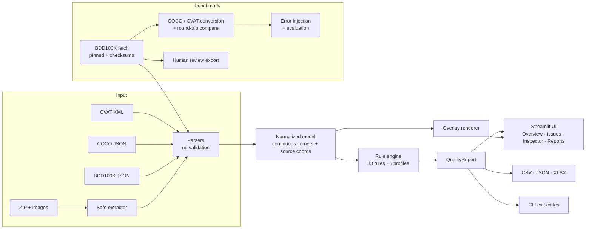

# LabelGuard

**Find broken and suspicious annotations in computer-vision datasets before they reach a
training run. Offline, deterministic, tested on real BDD100K data.**

[](https://github.com/Sodachan182/labelguard-annotation-qa/actions/workflows/ci.yml)


## What problem it solves

Annotation exports often contain mechanical mistakes: boxes outside the frame, zero-area
shapes, objects labelled twice, labels outside the ontology, self-intersecting polygons,
broken track visibility. They are cheap to detect and expensive to train on. LabelGuard
reads the export, runs 33 deterministic checks, and lets a reviewer look at every finding
on the real image.

It checks geometry, schema and consistency. It does **not** recognise image content, so it
cannot tell that a "car" is really a truck. Every finding is either **Structural** (the
data violates the format or geometry definition) or **Heuristic** (valid but suspicious;
a person decides).

## Formats

| Format | Read | Notes |
|---|---|---|
| CVAT for images 1.1 XML | boxes, polygons, polylines, points, skeletons, attributes | masks, ellipses, cuboids kept and reported as "not validated" |
| CVAT for video 1.1 XML | tracks, keyframes, `outside`, `occluded` | sparse keyframes follow CVAT interpolation semantics |
| COCO instances / keypoints JSON | `[x, y, w, h]` boxes, polygons, keypoints | RLE masks reported, not decoded |
| BDD100K / Scalabel JSON | per-image files, combined lists, Detection 2020 | inclusive `box2d` corners (`width = x2 − x1 + 1`) |
| ZIP | any of the above plus images | traversal, symlink and zip-bomb checks |

## What the 33 rules check

| Group | Rules | Examples |
|---|---:|---|
| Integrity | 9 | missing fields, non-numeric coordinates, duplicate ids, unknown categories, invalid image size, orphan annotations, attribute values outside the schema |
| Bounding boxes | 7 | zero area, negative size, outside the image, tiny, extreme aspect ratio, near-duplicates (IoU), conflicting labels |
| Polygons | 7 | too few vertices, self-intersection (Shapely), zero area, repeated vertices, outside the image, tiny, malformed |
| Keypoints | 4 | outside the image, malformed arrays, count vs schema, far from own box or mirrored |
| Video tracks | 6 | frames outside the task, empty tracks, re-entry without keyframe, jumps, sudden scale changes, gaps (opt-in) |

Thresholds are configurable and grouped into six profiles. Full table with descriptions
and default values: [docs/VALIDATION_RULES.md](docs/VALIDATION_RULES.md).

## Annotation Inspector

- The real image with overlays drawn through one coordinate transform. Alignment is
  checked pixel by pixel in tests and visually on a 61-box BDD100K street scene.
- The selected object gets a corner-tick highlight while everything else is dimmed.
  *Zoom to selection* is a real crop, capped at 5×, so small objects stay readable.
- Overlay modes: all, flagged, selected, hidden. Filter by class. Labels and ids can be
  toggled; labels are hidden automatically in scenes with more than 120 objects.
- Keyboard: ← → previous/next finding, Shift+← → previous/next image, Esc to clear.
- The details panel shows the rule, explanation and suggested fix, plus coordinates in the
  source convention next to the normalized corners.
- If an image file is missing, the panel says so and draws the geometry on a blank canvas.
  Nothing is faked.

Inspector screenshots show BDD100K photographs and are not published here. Run the app
locally to see them.

## Real-world results (BDD100K)

| Evidence | Smoke (20 images, 418 boxes) | Standard (100 images, 1,643 boxes) |
|---|---|---|
| Structural findings on the original labels | 0 | 0 |
| Heuristic findings on the original labels | 0 | 1 (an 8 × 5 px car, pending review) |
| Parse + validate | 121 ms | 294 ms |
| COCO round trip | 418/418 boxes, 0 px error | 1,643/1,643, 0 px |
| LabelGuard CVAT XML round trip | 418/418, 0.00005 px | 1,643/1,643, 0.00005 px |
| 27 injected errors (9 types) | 27 TP, 0 FP, 0 FN | 27 TP, 0 FP, 0 FN |
| Human-reviewed real candidates | not exported | 40 exported, **0 reviewed yet** |

**How to read this:**
- The injected errors were designed against known rules, so 27/27 shows that the rules
  fire correctly on real geometry without collateral noise. It is not a real-world
  detection rate.
- A real-world rate needs human review of real candidates. The tooling for that exists,
  and the review is pending.
- "CVAT XML round trip" means LabelGuard's own writer and parser, **not a CVAT server**.

Details and caveats: [docs/REAL_WORLD_EVALUATION.md](docs/REAL_WORLD_EVALUATION.md).

## What is not verified yet

- **CVAT server round trip:** scripted (`scripts/start-cvat.ps1`,
  `scripts/cvat_bdd100k_e2e.py`, CVAT v2.83.0 / `cvat-sdk==2.83.0`) and tested against a
  mock client, but never run against a real server. The development machine had no Docker
  and ~17 GB free disk.
- Detection 2020 labels: no reachable authorized source, so the 2018 labels are used.
- Video-track rules on real tracks (no BDD100K MOT data downloaded).
- The 500-image profile, and human review decisions.

## Reproduce

```powershell
py -3.12 -m venv .venv
```

```powershell
.\.venv\Scripts\python.exe -m pip install -e ".[dev]"
```

```powershell
.\.venv\Scripts\labelguard.exe bdd100k fetch --profile standard --accept-license
```

```powershell
.\.venv\Scripts\labelguard.exe bdd100k benchmark --profile standard
```

```powershell
.\.venv\Scripts\labelguard.exe bdd100k review-export --profile standard
```

```powershell
.\.venv\Scripts\python.exe -m pytest
```

`fetch` downloads ~17 MB of sampling metadata and ~7 MB of images and labels into the
git-ignored `data/` folder. It reads a pinned, checksum-verified, licence-permitted
redistribution, because the official BDD100K hosts were unreachable; see
[docs/BDD100K_INTEGRATION.md](docs/BDD100K_INTEGRATION.md). By passing `--accept-license`
you accept the BDD100K licence.

**Windows quick start:** double-click `START_LABELGUARD.bat`. It finds Python 3.12,
creates `.venv`, installs dependencies on first run and opens <http://localhost:8501>.
In the app, choose **Datasets → Load BDD100K sample**.

## CLI

```powershell
labelguard scan dataset.zip --profile video_tracking --fail-on warning
```

```powershell
labelguard report instances.json --format xlsx --out report.xlsx
```

Exit codes: `0` nothing at or above `--fail-on` (default `critical`), `1` findings at or
above it, `2` unreadable input. Reports come as CSV, JSON or a formatted Excel workbook,
with spreadsheet formula-injection protection.

## Architecture



Parsers never validate and rules never parse: each rule is a small class with a stable id,
kind, default severity and a `check()` generator. See [docs/ARCHITECTURE.md](docs/ARCHITECTURE.md).

## Testing

| Level | What | Needs | In CI |
|---|---|---|---|
| 1 | parsers, geometry, every rule, ZIP/XML/image safety, reports, CLI, overlays, conversions, review workflow, mocked CVAT orchestration, headless Streamlit pages and state | nothing | yes (Ubuntu + Windows, plus a clean wheel install) |
| 2 | checksums, image/label alignment, lossless conversion, injected-error benchmark | local BDD100K subset | skipped |
| 3 | real CVAT upload, import, export, compare | running CVAT | not run yet |

Local result at the last commit: **105 passed** (101 level 1 + 4 level 2), Ruff clean.
Browser QA: 60 captures (2 themes × 5 widths × 6 pages) with no overflow or exceptions,
plus Inspector edge-case checks (missing image, class filter, Esc, 130-character file
names).

## Security

Offline-first and localhost-only. `defusedxml`, hardened ZIP extraction, a
decompression-bomb fallback, per-import temp folders that are never reused, and formula
escaping. `pip-audit` reported no known vulnerabilities. See
[docs/SECURITY.md](docs/SECURITY.md).

## Limitations

- No semantic understanding; heuristic findings need a person.
- Masks (RLE), ellipses, cuboids and box rotation are reported but not checked.
- Evaluated on 20 and 100 BDD100K images with 2018 labels.
- The UI keeps datasets in memory. For very large datasets, use the CLI.

## License

Code: [MIT](LICENSE). BDD100K data and labels are **not** included and are subject to the
[BDD100K license](https://github.com/bdd100k/bdd100k/blob/master/doc/source/license.rst)
(© 2018 The Regents of the University of California). Bundled Geist fonts: SIL OFL
(`static/fonts/OFL.txt`).
