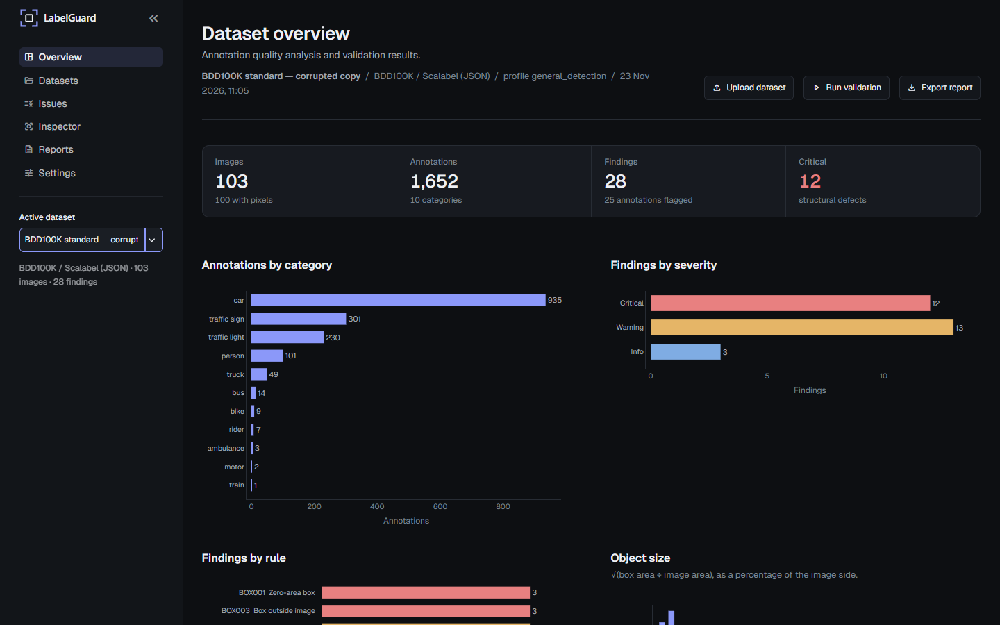
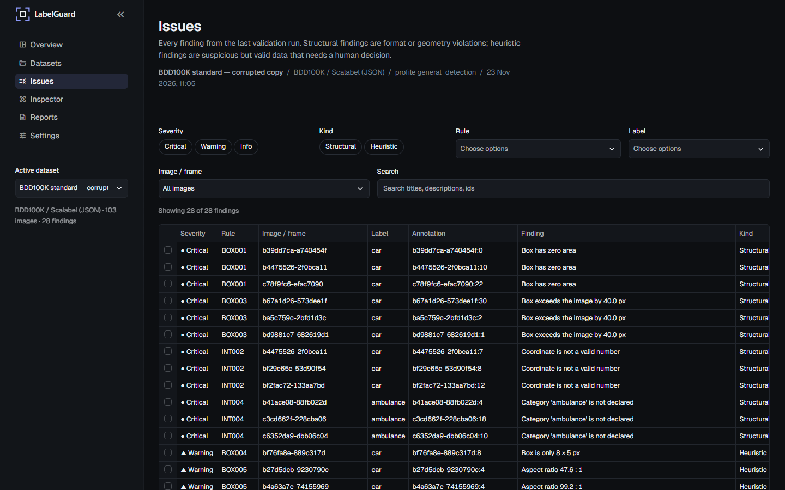
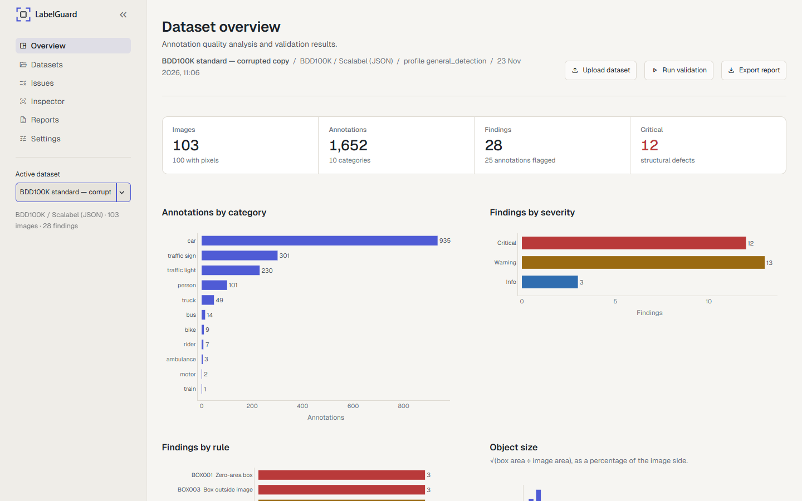
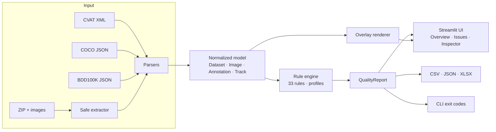

# LabelGuard

**Offline quality assurance for computer-vision annotation datasets.**
LabelGuard reads CVAT, COCO and BDD100K labels, runs 33 deterministic geometry and
schema checks, and lets you review every finding on the real image in an annotation
inspector, before bad labels reach a training run.

[](https://github.com/Sodachan182/labelguard-annotation-qa/actions/workflows/ci.yml)




<details>
<summary>More screens</summary>




Inspector screenshots show BDD100K photographs and are not included in the repository;
run the app locally to see real images with their overlays.
</details>

## Why

Annotation mistakes such as boxes outside the frame, zero-area shapes, duplicated objects,
labels outside the ontology and self-intersecting polygons are cheap to detect and
expensive to train on. Most teams find them late, by staring at model errors.
LabelGuard finds the mechanical ones up front and gives a reviewer a fast way to decide
on the suspicious ones.

It is honest about its scope: it checks geometry, schema and consistency. It does
**not** recognise image content, so it cannot tell you that a "car" is really a truck.
Every finding is labelled either **Structural** (the data violates the format or
geometry definition) or **Heuristic** (valid but suspicious, so a human decides).

## Features

- **Formats:** CVAT for images 1.1 XML, CVAT for video 1.1 XML (tracks, keyframes,
  `outside`), COCO instances / keypoints JSON, BDD100K / Scalabel JSON (per-image files,
  combined lists, Detection 2020), and ZIP archives of these with images.
- **33 rules** in five groups: integrity, bounding boxes, polygons (Shapely), keypoints,
  video tracks. Thresholds are configurable and grouped into profiles
  (general detection, instance segmentation, video tracking, face landmarks, seat belt,
  BDD100K driving). See [docs/VALIDATION_RULES.md](docs/VALIDATION_RULES.md).
- **Annotation inspector:** real pixels with exact overlays, a selection-corner
  highlight, zoom to selection (real crop, capped at 5×), flagged-only and per-class
  filters, keyboard navigation (← → findings, Shift+← → images, Esc), and coordinates
  shown both in the source convention and normalized.
- **Issue explorer** with severity, kind, rule, label, image and text filters.
- **Reports:** CSV, JSON and a formatted Excel workbook (Summary, Issues, Categories,
  Rules, Configuration), with spreadsheet formula-injection protection.
- **CLI** with stable exit codes for data pipelines.
- **Safe by default:** offline, localhost-only server, `defusedxml`, ZIP traversal and
  zip-bomb guards, originals never modified.

## Real-world validation: BDD100K

LabelGuard is tested on **real BDD100K dash-cam photographs and their original
annotations**, not on generated images.

| | Smoke | Standard |
|---|---:|---:|
| Real validation images | 20 | 100 |
| Original boxes | 418 | 1,643 |
| Findings on the original labels | 0 | 1 (heuristic: an 8 × 5 px car box) |
| Parse + validate time | 129 ms | 280 ms |
| COCO round trip (boxes matched, max corner error) | 418 / 418, 0 px | 1,643 / 1,643, 0 px |
| CVAT XML round trip | 418 / 418, 0.00005 px | 1,643 / 1,643, 0.00005 px |
| Injected errors detected (27 across 9 types) | 27 TP, 0 FP, 0 FN | 27 TP, 0 FP, 0 FN |

Measured on Windows 11, Python 3.12.10. The injected errors were designed against known
rules, so the 27/27 result shows that each rule fires on real geometry without collateral
noise. It is **not** an estimate of how many real-world labelling mistakes LabelGuard
would catch. Full method and caveats: [docs/REAL_WORLD_EVALUATION.md](docs/REAL_WORLD_EVALUATION.md).

```powershell
labelguard bdd100k fetch --profile smoke --accept-license
```

```powershell
labelguard bdd100k benchmark --profile smoke
```

The subset is downloaded into the git-ignored `data/` folder, verified file by file, and
never committed. Source, licence and the CVAT round trip are described in
[docs/BDD100K_INTEGRATION.md](docs/BDD100K_INTEGRATION.md). **CVAT status:** the
automation (`scripts/start-cvat.ps1`, `scripts/cvat_bdd100k_e2e.py`) is written but has
**not been run yet**; the development machine had no Docker and too little disk space.
The CVAT-format round trip above is LabelGuard's own writer and parser, not a CVAT server.

## Architecture



Parsers never validate and rules never parse: each rule is a small class with a stable id,
kind, default severity and a `check()` generator over the normalized model. Details:
[docs/ARCHITECTURE.md](docs/ARCHITECTURE.md).

## Quick start (Windows)

Double-click **`START_LABELGUARD.bat`**. It finds Python 3.12, creates `.venv`, installs
dependencies on first run and opens <http://localhost:8501>. No administrator rights are
needed and paths with spaces are fine.

Manual setup on any OS:

```powershell
py -3.12 -m venv .venv
```

```powershell
.\.venv\Scripts\python.exe -m pip install -e ".[dev]"
```

```powershell
.\.venv\Scripts\python.exe -m streamlit run app.py
```

## CLI

```powershell
labelguard scan annotations.xml
```

```powershell
labelguard scan dataset.zip --profile video_tracking --fail-on warning
```

```powershell
labelguard report instances.json --format xlsx --out report.xlsx
```

```powershell
labelguard rules --profile bdd100k_detection
```

Exit codes: `0` nothing at or above `--fail-on` (default `critical`), `1` findings at or
above it, `2` unreadable input.

## Testing

```powershell
.\.venv\Scripts\python.exe -m pytest
```

| Level | What | Needs | Runs in CI |
|---|---|---|---|
| 1. Unit + UI | parsers, geometry, every rule, ZIP/XML safety, reports, CLI, overlays, conversions, headless Streamlit pages | nothing | yes |
| 2. Real data | checksums, image/label alignment, lossless conversion, injected-error benchmark | local BDD100K subset | no (skipped) |
| 3. CVAT end to end | upload, import, export, compare, validate | running CVAT | no, not run yet |

Current local result: **95 passed** (91 level-1 tests and 4 real-data tests), Ruff clean.
Visual QA covered 60 browser captures (dark and light themes; 1920, 1440, 1366, 1024 and
390 px widths) with no horizontal overflow and no exceptions.

## Security

Offline-first: no network calls during validation, the server binds to `localhost`, and
uploads are copied to a temporary session folder. XML goes through `defusedxml`; ZIP
members are checked for traversal, absolute paths, symlinks, size and compression ratio
before extraction. See [docs/SECURITY.md](docs/SECURITY.md).

## Limitations

- No semantic understanding of image content; heuristic findings need a human decision.
- Masks (RLE), ellipses, cuboids and box rotation are kept and reported as "not
  validated" rather than checked.
- BDD100K evaluation uses 20 and 100 images and the original 2018 per-image labels
  (the Detection 2020 re-checked labels were not reachable). Injected errors are synthetic.
- The CVAT server round trip has not been executed yet.
- The UI keeps datasets in memory; very large datasets (hundreds of thousands of boxes)
  are better scanned with the CLI.

## Roadmap

Run the CVAT end-to-end test on a machine with Docker; decode RLE masks; YOLO import;
BDD100K MOT tracking subset for the video rules on real tracks; persisted review
decisions ("accepted / fixed / ignored") exported back to CVAT.

## License

LabelGuard source code: [MIT](LICENSE). BDD100K data and labels are **not** covered by
this licence and are not included in the repository; they are subject to the
[BDD100K license](https://github.com/bdd100k/bdd100k/blob/master/doc/source/license.rst)
(© 2018 The Regents of the University of California). Bundled Geist fonts: SIL Open Font
License (`static/fonts/OFL.txt`).
