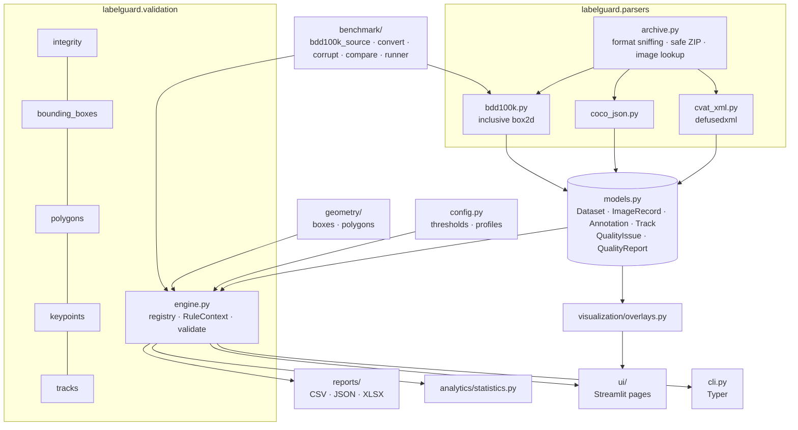

# Architecture

## Principles

- **Parsers never validate; rules never parse.** A parser turns a file into the normalized
  model and records problems it met as `parse_errors` (a bad value becomes NaN plus a
  message; nothing is dropped). Rules read only the model.
- **One coordinate space.** Every box becomes continuous corners `[x1, y1, x2, y2]`; the
  source representation stays in `bbox_source` so reports quote the original.
- **Rules are small classes** with a stable id, group, kind (structural or heuristic),
  default severity, description and suggested action. `@register` adds them to the
  registry; `validate()` runs the rules active in a profile, applies severity overrides,
  deduplicates by a deterministic issue id (`LG-` + hash of dataset, rule, image,
  annotation and key) and times each rule.
- **No cascades.** Heuristics skip shapes with structural defects, KPT003 skips
  annotations KPT002 already rejected, and box rules ignore CVAT `outside` shapes.

## Data model

| Entity | Key fields |
|---|---|
| `Dataset` | id, name, source format, images, annotations, categories, tracks, frame range, parse warnings, image paths |
| `ImageRecord` | id, file name, width, height, frame, raw (source id, size source, scene attributes) |
| `Annotation` | id, image id, frame, track id, category, geometry type, `bbox`, `bbox_source`, polygons, points, keypoint visibility, attributes, occluded, outside, keyframe, source location, parse errors |
| `QualityIssue` | issue id, rule id, severity, kind, dataset / image / frame / annotation / track id, category, title, description, evidence, suggested action, source location |
| `QualityReport` | issues, rules run, config snapshot, counts, timings |

## UI

`app.py` → `labelguard.ui.app.main()` builds `st.navigation` with six pages. Session state
(`ui/state.py`) holds loaded datasets, the active dataset, the selected finding and
annotation, and settings persisted to `~/.labelguard/settings.json`. The Inspector renders
overlays server-side with Pillow through one `ViewTransform`
(`canvas = (source − window origin) × scale`), which `tests/test_overlay_and_benchmark.py`
checks pixel by pixel.

## Tests

`tests/` holds level 1 (unit, CLI and headless Streamlit `AppTest` pages) and level 2 (real
data, marked `realdata`, skipped without the local subset). Level 3 (CVAT) is the script
`scripts/cvat_bdd100k_e2e.py`.
